<p align="center">
  <a href="https://www.themes.dev/free/?ref=github">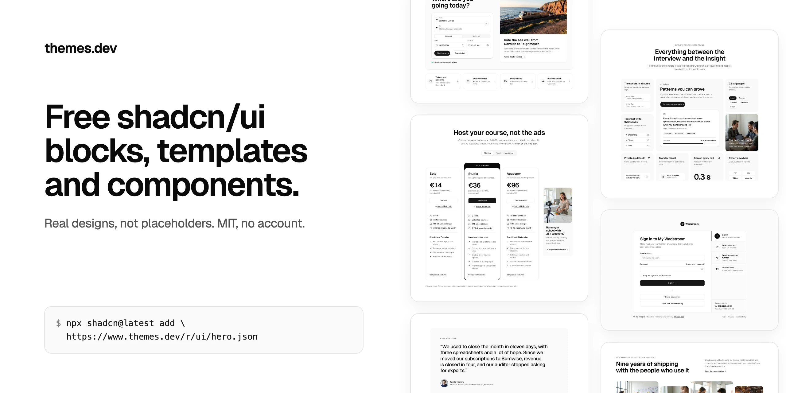</a>
</p>

<h1 align="center">themes.dev UI</h1>

<p align="center">
  Free <a href="https://ui.shadcn.com">shadcn/ui</a> blocks, page templates and components, plus a native Astro kit.<br>
  Real designs, not placeholders. One command to install, no account, MIT.
</p>

<p align="center">
  <a href="https://www.themes.dev/ui/?ref=github"><b>Live demo</b></a> ·
  <a href="https://www.themes.dev/free/?ref=github">All free items</a> ·
  <a href="https://www.themes.dev/compose/?ref=github">Page composer</a> ·
  <a href="https://github.com/themesdev/mcp">MCP server</a> ·
  <a href="https://www.themes.dev/pricing/?ref=github">UI Pro</a>
</p>

<p align="center">
  <a href="https://github.com/themesdev/ui/stargazers"></a>
  <a href="LICENSE"></a>
  
  
</p>

## Install

Every item installs with the shadcn CLI, straight from our site. No clone, no account, no key.

```bash
npx shadcn@latest add https://www.themes.dev/r/ui/hero.json
```

Swap `hero` for any name below. The CLI also pulls in the shadcn/ui components and npm packages the item needs. Run
`npx shadcn@latest init` first if your project doesn't use shadcn/ui yet. Prefer to let your editor do it? The
[MCP server](https://github.com/themesdev/mcp) searches and installs these from Cursor or Claude Code.

If this saves you an afternoon, a ⭐ on this repo helps other people find it.

## 23 blocks

Page sections most sites need. Each block is one finished design, filled in for a made-up business so you can see it
working. Words, links, list items and photos come in as props with defaults, so you replace the content and keep the
layout. They are built on real shadcn/ui parts, so they take on your theme and work in light and dark mode. Blocks
without state render on the server.

<table>
<tr><td align="center" valign="top" width="25%"><a href="https://www.themes.dev/ui/blocks/hero/?ref=github">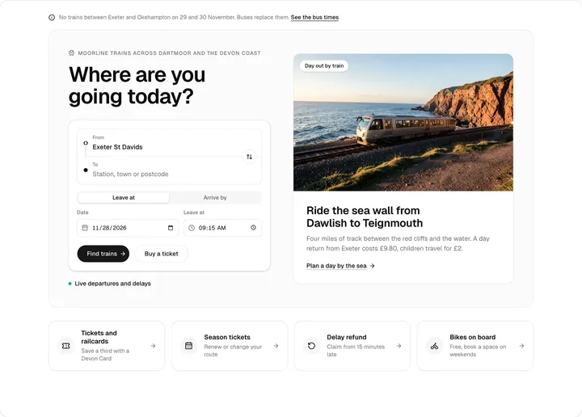</a><br><a href="https://www.themes.dev/ui/blocks/hero/?ref=github"><b>Hero</b></a><br><code>hero</code></td><td align="center" valign="top" width="25%"><a href="https://www.themes.dev/ui/blocks/pricing/?ref=github">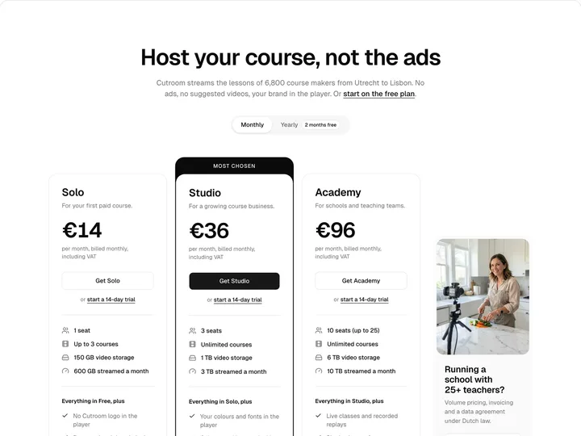</a><br><a href="https://www.themes.dev/ui/blocks/pricing/?ref=github"><b>Pricing</b></a><br><code>pricing</code></td><td align="center" valign="top" width="25%"><a href="https://www.themes.dev/ui/blocks/faq/?ref=github">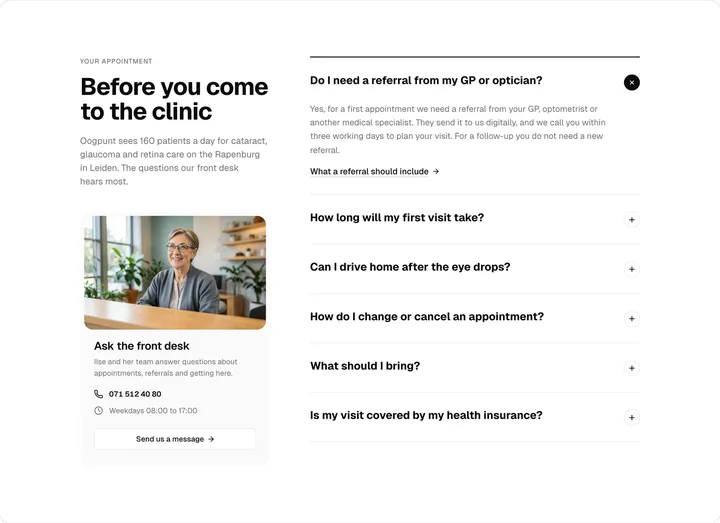</a><br><a href="https://www.themes.dev/ui/blocks/faq/?ref=github"><b>FAQ</b></a><br><code>faq</code></td><td align="center" valign="top" width="25%"><a href="https://www.themes.dev/ui/blocks/site-header/?ref=github">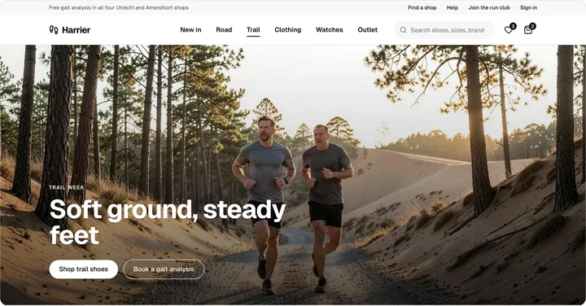</a><br><a href="https://www.themes.dev/ui/blocks/site-header/?ref=github"><b>Site header</b></a><br><code>site-header</code></td></tr>
<tr><td align="center" valign="top" width="25%"><a href="https://www.themes.dev/ui/blocks/site-footer/?ref=github">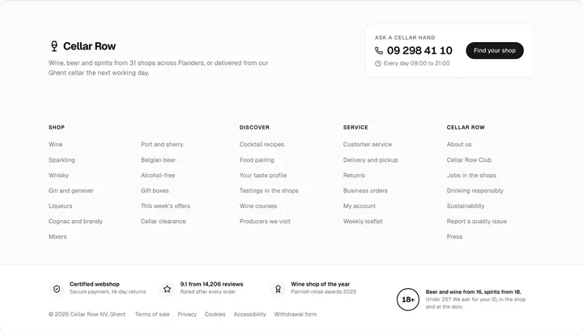</a><br><a href="https://www.themes.dev/ui/blocks/site-footer/?ref=github"><b>Site footer</b></a><br><code>site-footer</code></td><td align="center" valign="top" width="25%"><a href="https://www.themes.dev/ui/blocks/newsletter/?ref=github">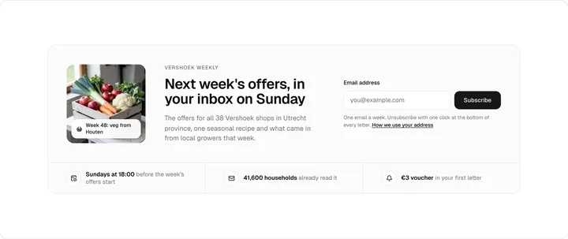</a><br><a href="https://www.themes.dev/ui/blocks/newsletter/?ref=github"><b>Newsletter signup</b></a><br><code>newsletter</code></td><td align="center" valign="top" width="25%"><a href="https://www.themes.dev/ui/blocks/contact-form/?ref=github">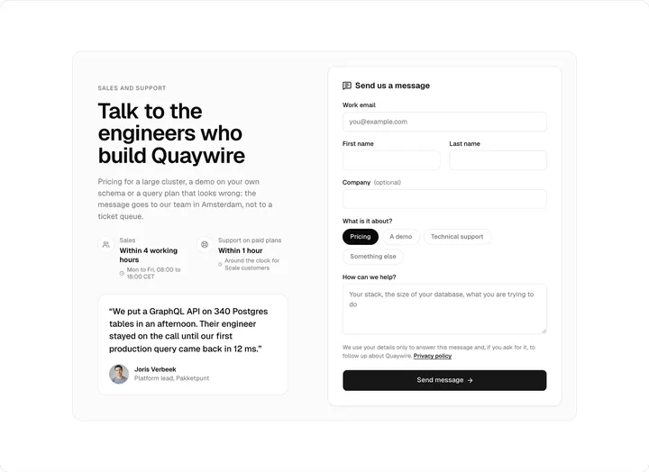</a><br><a href="https://www.themes.dev/ui/blocks/contact-form/?ref=github"><b>Contact form</b></a><br><code>contact-form</code></td><td align="center" valign="top" width="25%"><a href="https://www.themes.dev/ui/blocks/logo-strip/?ref=github">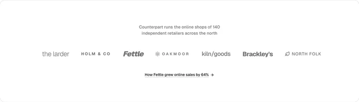</a><br><a href="https://www.themes.dev/ui/blocks/logo-strip/?ref=github"><b>Logo strip</b></a><br><code>logo-strip</code></td></tr>
<tr><td align="center" valign="top" width="25%"><a href="https://www.themes.dev/ui/blocks/login-form/?ref=github">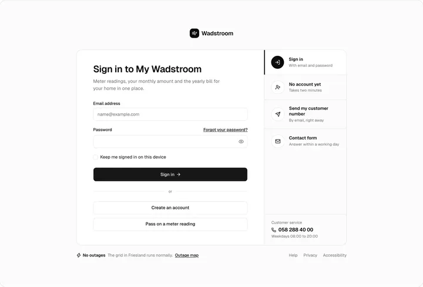</a><br><a href="https://www.themes.dev/ui/blocks/login-form/?ref=github"><b>Login form</b></a><br><code>login-form</code></td><td align="center" valign="top" width="25%"><a href="https://www.themes.dev/ui/blocks/breadcrumb-trail/?ref=github">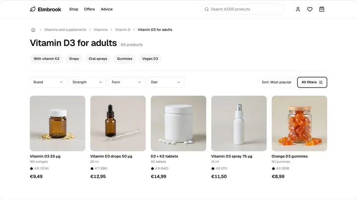</a><br><a href="https://www.themes.dev/ui/blocks/breadcrumb-trail/?ref=github"><b>Breadcrumb trail</b></a><br><code>breadcrumb-trail</code></td><td align="center" valign="top" width="25%"><a href="https://www.themes.dev/ui/blocks/card-carousel/?ref=github">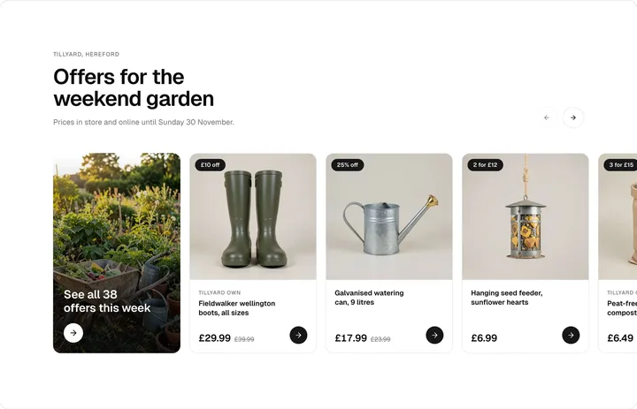</a><br><a href="https://www.themes.dev/ui/blocks/card-carousel/?ref=github"><b>Card carousel</b></a><br><code>card-carousel</code></td><td align="center" valign="top" width="25%"><a href="https://www.themes.dev/ui/blocks/comparison-table/?ref=github">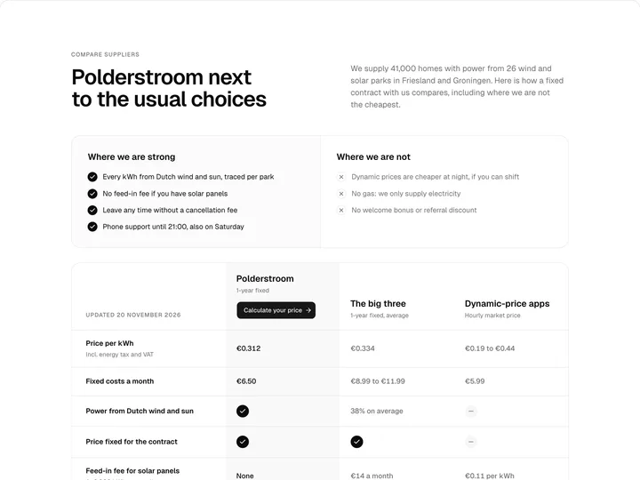</a><br><a href="https://www.themes.dev/ui/blocks/comparison-table/?ref=github"><b>Comparison table</b></a><br><code>comparison-table</code></td></tr>
<tr><td align="center" valign="top" width="25%"><a href="https://www.themes.dev/ui/blocks/header-bar/?ref=github">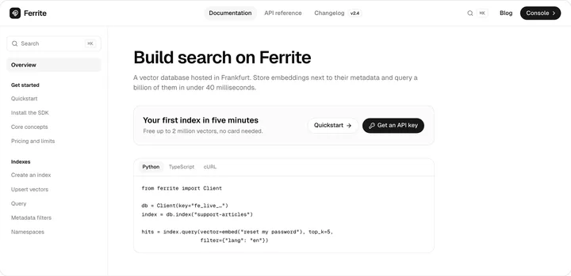</a><br><a href="https://www.themes.dev/ui/blocks/header-bar/?ref=github"><b>Header bar</b></a><br><code>header-bar</code></td><td align="center" valign="top" width="25%"><a href="https://www.themes.dev/ui/blocks/lift-card/?ref=github">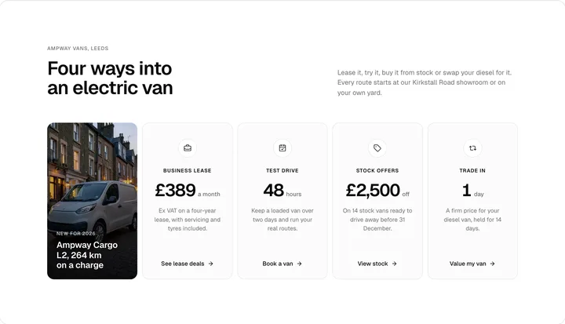</a><br><a href="https://www.themes.dev/ui/blocks/lift-card/?ref=github"><b>Lift cards</b></a><br><code>lift-card</code></td><td align="center" valign="top" width="25%"><a href="https://www.themes.dev/ui/blocks/link-card/?ref=github">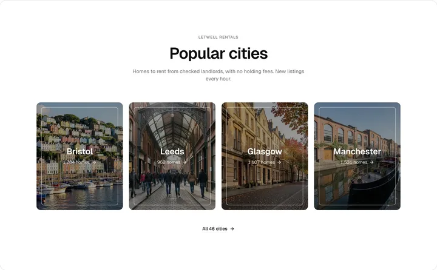</a><br><a href="https://www.themes.dev/ui/blocks/link-card/?ref=github"><b>Link cards</b></a><br><code>link-card</code></td><td align="center" valign="top" width="25%"><a href="https://www.themes.dev/ui/blocks/plain-tiles/?ref=github">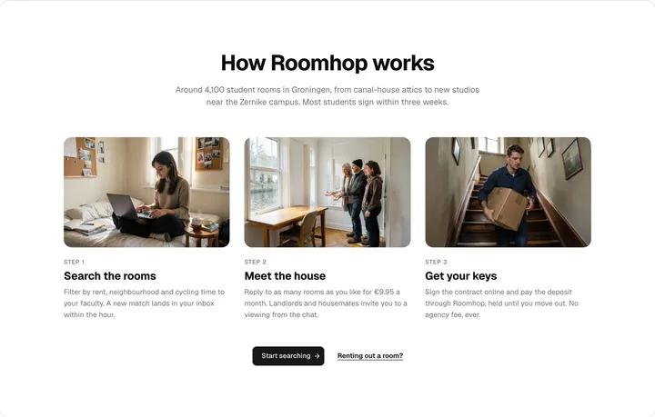</a><br><a href="https://www.themes.dev/ui/blocks/plain-tiles/?ref=github"><b>Plain tiles</b></a><br><code>plain-tiles</code></td></tr>
<tr><td align="center" valign="top" width="25%"><a href="https://www.themes.dev/ui/blocks/split-card/?ref=github">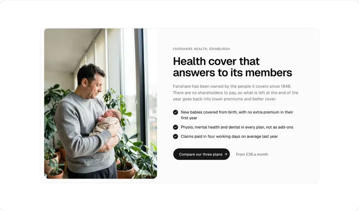</a><br><a href="https://www.themes.dev/ui/blocks/split-card/?ref=github"><b>Split card</b></a><br><code>split-card</code></td><td align="center" valign="top" width="25%"><a href="https://www.themes.dev/ui/blocks/feature-grid/?ref=github">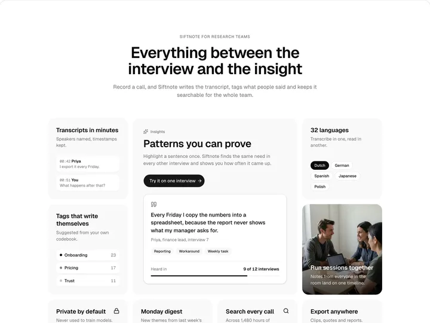</a><br><a href="https://www.themes.dev/ui/blocks/feature-grid/?ref=github"><b>Feature grid</b></a><br><code>feature-grid</code></td><td align="center" valign="top" width="25%"><a href="https://www.themes.dev/ui/blocks/call-to-action/?ref=github">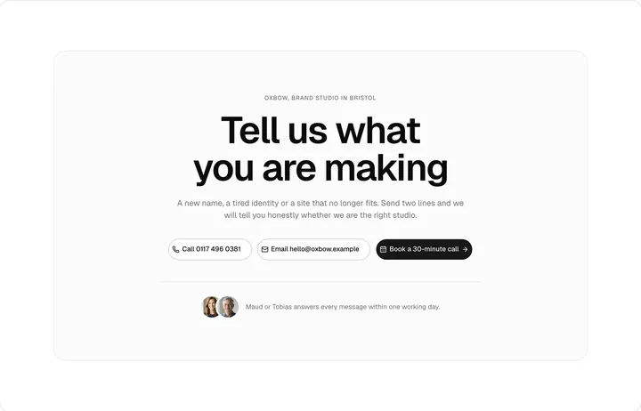</a><br><a href="https://www.themes.dev/ui/blocks/call-to-action/?ref=github"><b>Call to action</b></a><br><code>call-to-action</code></td><td align="center" valign="top" width="25%"><a href="https://www.themes.dev/ui/blocks/stats-row/?ref=github">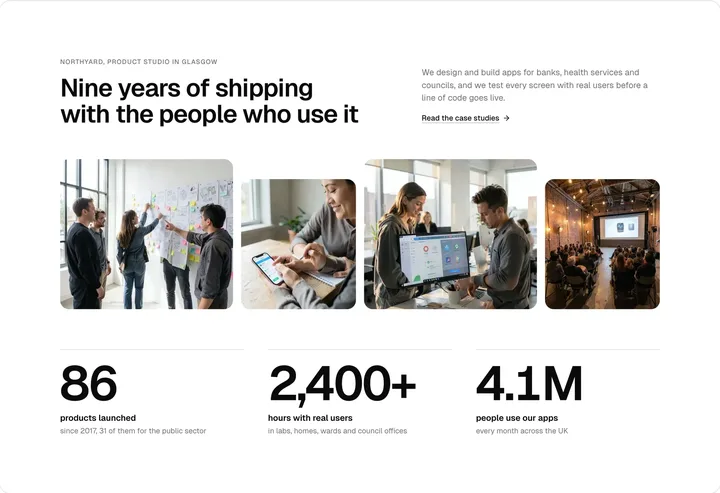</a><br><a href="https://www.themes.dev/ui/blocks/stats-row/?ref=github"><b>Stats row</b></a><br><code>stats-row</code></td></tr>
<tr><td align="center" valign="top" width="25%"><a href="https://www.themes.dev/ui/blocks/testimonial/?ref=github">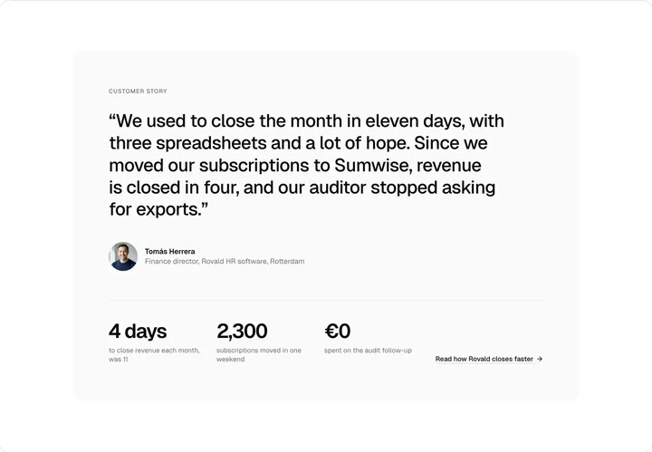</a><br><a href="https://www.themes.dev/ui/blocks/testimonial/?ref=github"><b>Testimonial</b></a><br><code>testimonial</code></td><td align="center" valign="top" width="25%"><a href="https://www.themes.dev/ui/blocks/post-grid/?ref=github">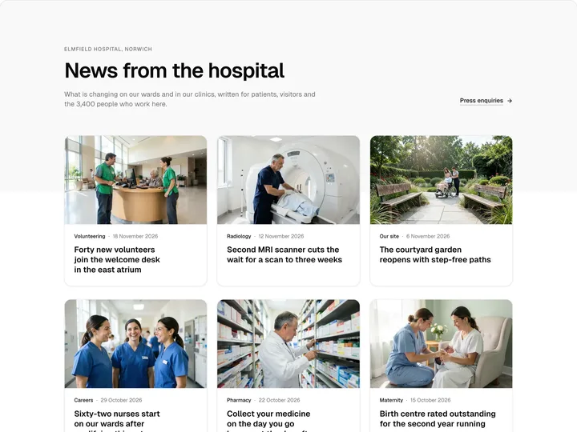</a><br><a href="https://www.themes.dev/ui/blocks/post-grid/?ref=github"><b>Post grid</b></a><br><code>post-grid</code></td><td align="center" valign="top" width="25%"><a href="https://www.themes.dev/ui/blocks/changelog-list/?ref=github">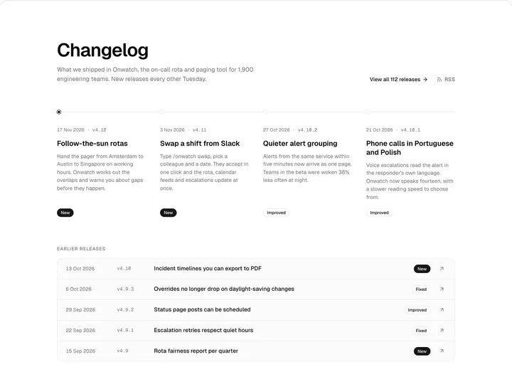</a><br><a href="https://www.themes.dev/ui/blocks/changelog-list/?ref=github"><b>Changelog list</b></a><br><code>changelog-list</code></td><td align="center" valign="top" width="25%"></td></tr>
</table>

## 2 page templates

Whole pages put together from the free blocks, so you can see how the parts fit. They install the same way, with the
blocks they use:

```bash
npx shadcn@latest add https://www.themes.dev/r/ui/free-home.json
```

<table>
<tr><td align="center" valign="top" width="25%"><a href="https://www.themes.dev/templates/free-home/?ref=github">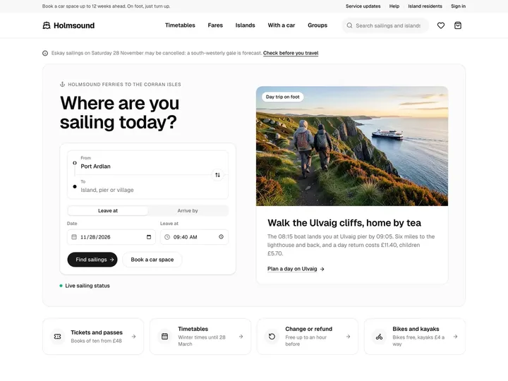</a><br><a href="https://www.themes.dev/templates/free-home/?ref=github"><b>Home page</b></a><br><code>free-home</code></td><td align="center" valign="top" width="25%"><a href="https://www.themes.dev/templates/free-sign-in/?ref=github">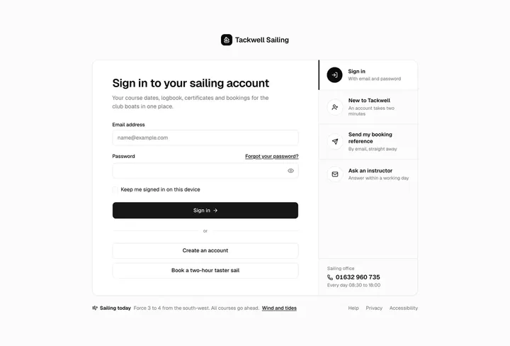</a><br><a href="https://www.themes.dev/templates/free-sign-in/?ref=github"><b>Sign-in page</b></a><br><code>free-sign-in</code></td><td align="center" valign="top" width="25%"></td><td align="center" valign="top" width="25%"></td></tr>
</table>

## 57 components

shadcn/ui is the base. 34 of these are shadcn's own components; their install line simply gives you shadcn's
component, and we show them with real examples on the site. The other 23 are ours, for patterns shadcn doesn't ship:

`announcement`, `bar-chart`, `code-block`, `copy-button`, `date-field`, `filter-bar`, `filter-sheet`,
`language-switcher`, `link`, `link-list`, `map-embed`, `quantity`, `read-aloud`, `result-list`, `search-field`,
`section-header`, `sidebar-nav`, `steps`, `story-card`, `tag`, `toc`, `toolbar`, `video-player`.

## Astro kit (15 items)

Plain `.astro` components for content sites, no React needed: `seo`, `json-ld`, `breadcrumbs`, `pagination`, `toc`,
`skip-link`, `figure`, `prose`, `code-block`, `portable-text`, `time`, `theme-toggle`, `rss-feed`, `llms-txt`,
`robots-txt`. They install from their own path:

```bash
npx shadcn@latest add https://www.themes.dev/astro/r/<name>.json
```

## Layout

```
registry/blocks/<name>/       the block (<name>.tsx), its metadata, and for some a demo with page context
registry/ui/<name>/           our components
registry/templates/<name>/    the page templates
registry/catalog.json         every block and component: name, kind, category, title, description
examples/<name>.tsx           an example for each component
astro/kit/, astro/kit.json    the Astro kit and its index
r/                            the built registry items, the same JSON the install commands fetch
assets/                       the pictures in this readme
```

Photos in the source point at `/ui/photos/...` on our site. The built items in `r/` use full URLs, so the
images load wherever you install a block. Swap them for your own.

## More from themes.dev

- [themes.dev/icons](https://github.com/themesdev/icons): free SVG icons in one style, Lucide names, React drop-in.
- [themes.dev/mcp](https://github.com/themesdev/mcp): search and install these blocks from Cursor, Claude Code or any MCP client.
- [Recto](https://github.com/themesdev/recto-astro): a free blog template for Astro and Sanity.
- [UI Pro](https://www.themes.dev/pricing/?ref=github): our paid library, with many more blocks and whole-site themes.

## Built with themes.dev UI

Using these blocks on a live site? [Add it to the showcase](https://github.com/themesdev/ui/issues/new?template=showcase.yml)
and we list it here, with a link.

<!-- showcase: one line per site, newest first: - [Name](https://url): what they used (by @handle) -->
_Your site could be the first one here._

## Contributing

Found a bug or a rough edge in a free item? [Open an issue](https://github.com/themesdev/ui/issues). Small fixes are
welcome as pull requests; this repo is assembled from our own source, so we apply them there and credit you in the commit.
Questions: info@themes.dev.

## License

MIT. See [LICENSE](LICENSE).
